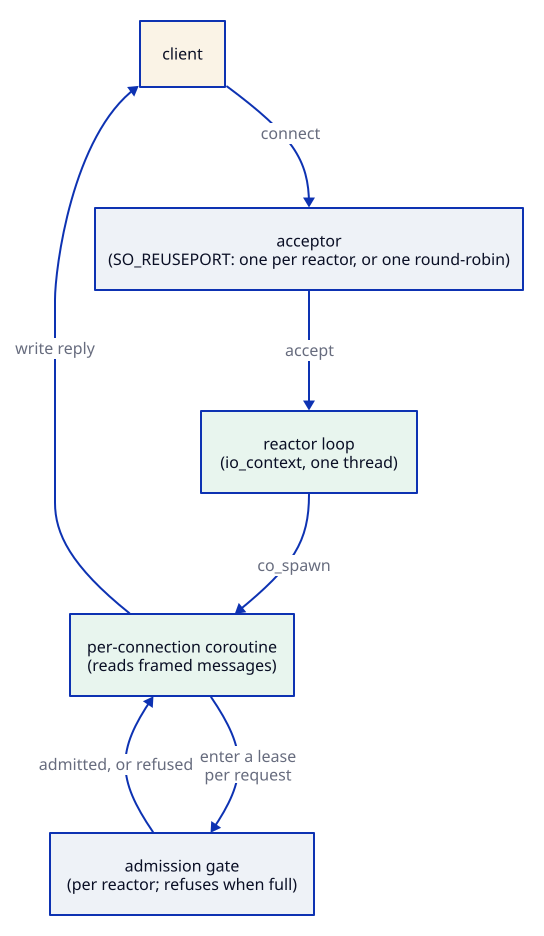

# reactor

[](https://github.com/Kronuz/reactor/actions/workflows/ci.yml)
[](LICENSE)


A thread-per-core server runtime on standalone Asio and C++20 coroutines: the
event-loop pool, the accept loop, the offload pool, and a shutdown that never
hangs, with the protocol left entirely to you. Write one coroutine per
connection; reactor runs it. For TCP and UDP services that should not each
reinvent their plumbing.



## ✨ Highlights

- **Shared-nothing loops**: N reactors on N threads, no global lock.
- **One port, best bind mode**: `SO_REUSEPORT` per reactor on Linux, one shared
  acceptor elsewhere, chosen automatically.
- **Offload with backpressure**: each reactor has a worker pool and a bounded
  admission gate, so saturation sheds load instead of queueing forever.
- **Shutdown that finishes**: `stop()` aborts tracked waits, reaps accepts, waits
  for sessions to return, then joins.
- **Connection limits** with exact accounting, and accept retry under descriptor
  pressure.
- **UDP too**: `UdpServer` with multicast, for gossip and discovery.
- **Optional TLS** (`reactor::tls`), used by [http](https://github.com/Kronuz/http)
  and [consensus](https://github.com/Kronuz/consensus)'s transport: mutual TLS between
  peers, servers with just a certificate and key, clients that trust a private
  authority or the system's roots, and an opt-in `strict` mode (forward-secret AEAD
  suites only in TLS 1.2, no session resumption).

## 📦 Installation

Requires a C++20 compiler and CMake 3.16 or newer; it fetches standalone Asio
(`asio-1-36-0`), or uses `-DASIO_INCLUDE_DIR`. TLS needs OpenSSL 3. CI builds it
on Linux (x86_64, arm64), macOS (arm64, x86_64), and FreeBSD, plus ASan, UBSan,
and TSan builds.

```cmake
include(FetchContent)
FetchContent_Declare(reactor
  GIT_REPOSITORY https://github.com/Kronuz/reactor.git
  GIT_TAG        main)
FetchContent_MakeAvailable(reactor)

target_link_libraries(my_app PRIVATE reactor::reactor)   # and reactor::tls for TLS
```

## 🚀 Quick start

An echo server on four reactors:

```cpp
#include "reactor.h"

asio::awaitable<void> echo(asio::ip::tcp::socket socket, reactor::Reactor&) {
	char buf[1024];
	for (;;) {
		std::size_t n = co_await socket.async_read_some(asio::buffer(buf), asio::use_awaitable);
		co_await asio::async_write(socket, asio::buffer(buf, n), asio::use_awaitable);
	}
}

int main() {
	reactor::TcpServer server(/*reactors*/ 4, /*offload workers*/ 2, /*queue*/ 256, echo);
	server.start(8080);   // binds, listens, and returns once every acceptor is ready
	// ... run until a signal ...
	server.stop();        // call from outside the reactors
}
```

[`examples/echo_server.cc`](examples/echo_server.cc) is this server, runnable.
`benchmarks/echo_bench.cc` measures it at about 55,000 requests per second on four
reactors on a laptop.

## 🎯 When to use it

- ✅ A custom TCP or UDP protocol server that needs cores, backpressure, and a
  clean shutdown.
- ❌ HTTP: use [http](https://github.com/Kronuz/http), which builds on this.
- ❌ A client library: this runs servers.

## 📚 Documentation

- [docs/API.md](docs/API.md): what a Session gets, and the UDP server.
- [ARCHITECTURE.md](ARCHITECTURE.md): the loops, the bind modes, the offload pool,
  and the shutdown and admission contracts.
- [AGENTS.md](AGENTS.md): repository map, invariants, and traps.

## 🛠️ Building and testing

```sh
cmake -B build -DCMAKE_BUILD_TYPE=Release && cmake --build build
ctest --test-dir build --output-on-failure
```

## 🤝 Contributing

Issues and pull requests are welcome. Shutdown changes need tests for every stop
point; read [AGENTS.md](AGENTS.md) first. CI must pass on every platform.

## 📄 License

MIT, Copyright (c) 2026 Germán Méndez Bravo. See [LICENSE](LICENSE).
