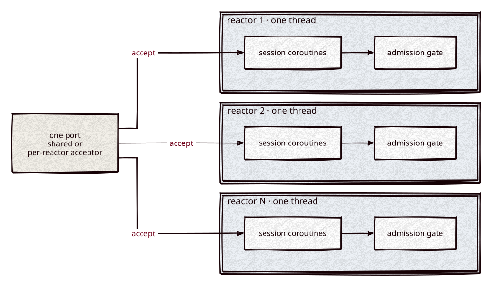

# reactor

Part of [Kronuz C++ Libraries](https://github.com/Kronuz/cpp-libraries), a collection of small, reusable C++ libraries.

[](https://github.com/Kronuz/reactor/actions/workflows/ci.yml)
[](LICENSE)


Thread-per-core TCP and UDP server runtime for C++20 on standalone Asio: coroutine sessions,
admission, bounded shutdown. reactor owns the event-loop pool, the accept loop, per-reactor
admission and a shutdown that finishes; the protocol is yours, written as one coroutine per
connection. Reach for it for a custom protocol server that should not reinvent that plumbing.



## ✨ Highlights

- **Shared-nothing loops.** N reactors on N threads, each its own `asio::io_context`, with no
  global lock and no worker pool: a session that must wait suspends its coroutine.
- **One port, two bind modes.** By default one acceptor hands connections to the reactors in
  turn; `BindOptions::reuse_port` gives each reactor its own `SO_REUSEPORT` acceptor on Linux.
- **Admission with backpressure.** Each reactor has a bounded `AdmissionGate`. A full gate
  refuses the request, and the session answers with its protocol's busy signal instead of
  queueing it.
- **Shutdown that finishes.** `stop()` asks every tracked request to stop on its own loop, reaps
  the accepts, gives sessions a grace period (5 s by default), forces what a stalled peer still
  holds, then joins.
- **Connection limits** with exact accounting, and accept retry under descriptor pressure.
- **UDP too.** `UdpServer` with multicast, for gossip and discovery. A handler that throws costs
  one datagram; the receive loop keeps running.
- **Optional TLS.** `reactor::tls` (OpenSSL 3) configures mutual TLS between peers, servers with a
  certificate and key, clients that trust a private authority or the system's roots, and a
  `strict` mode: forward-secret AEAD suites only in TLS 1.2, no session resumption.

## 🚀 Quick start

An echo server on four reactors:

```cpp
#include "reactor.h"

#include <cstdio>

asio::awaitable<void> echo(asio::ip::tcp::socket socket, reactor::Reactor&) {
	char buf[1024];
	try {
		for (;;) {
			std::size_t n = co_await socket.async_read_some(asio::buffer(buf), asio::use_awaitable);
			co_await asio::async_write(socket, asio::buffer(buf, n), asio::use_awaitable);
		}
	} catch (const std::exception&) {}  // the peer closed
}

int main() {
	reactor::TcpServer server(/*reactors*/ 4, /*in flight per reactor*/ 256, echo);
	server.start(8080);  // binds, listens, and returns once every acceptor is ready
	std::getchar();      // meanwhile, a client on port 8080 gets its bytes back
	server.stop();       // call from outside the reactors
}
```

[`examples/echo_server.cc`](examples/echo_server.cc) is the same server, stopped by a signal.

## 📦 Installation

Requires a C++20 compiler and CMake 3.16 or newer. CMake fetches standalone Asio
(`asio-1-36-0`), or `-DASIO_INCLUDE_DIR` points it at an existing copy; `reactor::tls` needs
OpenSSL 3. CI builds and tests it on Linux (x86_64 with GCC and Clang, arm64), macOS (arm64,
x86_64) and FreeBSD, plus ASan + UBSan and TSan builds.

```cmake
include(FetchContent)
FetchContent_Declare(reactor
  GIT_REPOSITORY https://github.com/Kronuz/reactor.git
  GIT_TAG        76c32b44de7632909e1287c76ea0f36c5f75d695)  # or main to track the tip
FetchContent_MakeAvailable(reactor)

target_link_libraries(my_app PRIVATE reactor::reactor)  # and reactor::tls for TLS
```

```cpp
#include "reactor.h"      // TcpServer, Reactor, AdmissionGate
#include "reactor_udp.h"  // UdpServer
#include "reactor_tls.h"  // reactor::tls
```

## 🎯 When to use it

A custom TCP or UDP protocol server that needs every core, backpressure and a clean shutdown.

Not for:

- HTTP: use [http](https://github.com/Kronuz/http), which builds on this.
- A client library: reactor runs servers.
- Blocking work inside a session: it stalls every connection on that reactor's thread. Hand it to
  a thread pool and `co_await` the result.

## 📚 Documentation

- [docs/API.md](docs/API.md): what a session gets, the UDP server, and the callback failure
  contract.
- [ARCHITECTURE.md](ARCHITECTURE.md): the loops, the bind modes, admission, and the shutdown
  stages.
- [AGENTS.md](AGENTS.md): repository map, invariants, and traps.
- [Catalog entry](https://github.com/Kronuz/cpp-libraries/blob/main/AGENTS.md#reactor) in Kronuz
  C++ Libraries.

## 🛠️ Building and testing

```sh
cmake -B build -DCMAKE_BUILD_TYPE=Release && cmake --build build
ctest --test-dir build --output-on-failure
./build/reactor_echo_bench
```

The benchmark (`reactor_echo_bench [reactors] [clients] [ops-per-client]`, by default 4, 32 and
20000) runs an echo server against concurrent loopback clients and prints throughput and latency.

## 🤝 Contributing

Issues and pull requests are welcome. Read [AGENTS.md](AGENTS.md) and the catalog's
[rules of engagement](https://github.com/Kronuz/cpp-libraries/blob/main/AGENTS.md#rules-of-engagement)
first; a shutdown change needs a test for every stop point.

## 📄 License

MIT. See [LICENSE](LICENSE).
